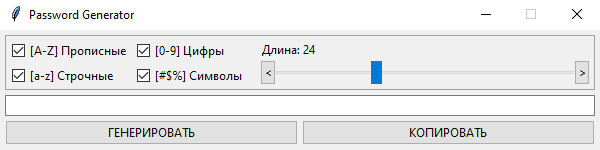

# Password Generator


Утилита с открытым исходным кодом для создания криптографически стойких паролей. Используется модуль `secrets` (CSPRNG), а не `random`. Подробнее о важности надежных паролей — в [статье](https://lezhebokin.github.io/document/entropy-and-diceware.html) автора



## Возможности

- Генерация криптографически стойких паролей
- Настройка длины и используемых символов

## Системные требования

- 🖥️ Windows 10<br/>
- 🐍 Python 3.6+

> [!WARNING]
> Работоспособность на Linux и macOS не проверялась и не гарантируется

## Установка и запуск

Клонируйте репозиторий

```bash
git clone https://github.com/lezhebokin/password-generator.git
```

> [!NOTE]
> Внешних зависимостей нет — используется только стандартная библиотека Python

Перейдите в его директорию
```bash
cd password-generator
```

Запустите программу

```bash
python main.py
```

## Использование

1. Задайте длину пароля
2. Отметьте нужные наборы символов
3. Нажмите «ГЕНЕРИРОВАТЬ»

## Сборка исполняемого файла

Создайте виртуальное окружение

```bash
python -m venv .venv
```

Активируйте его

```bash
.venv\Scripts\activate
```

Установите модуль PyInstaller

```bash
pip install pyinstaller
```

Выполните в корне проекта

```bash
pyinstaller --clean --noconsole --onedir --name password-generator --contents-directory library main.py
```

После сборки в директории `dist\password-generator` появятся исполняемый файл и все необходимые зависимости

## Лицензия

Проект распространяется под лицензией [BSD-3-Clause](https://github.com/lezhebokin/password-generator/blob/main/LICENSE)
